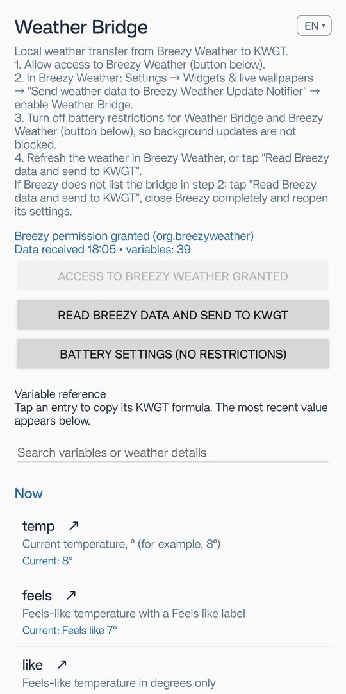

# Weather Bridge for KWGT

[Русский](README.md) · **English**

**Weather Bridge** is a tiny Android app that passes the forecast from
[Breezy Weather](https://github.com/breezy-weather/breezy-weather) to
[KWGT](https://kustom.rocks/) as ready-to-use variables. It makes no network requests and does
not use your location: Breezy fetches the weather, the bridge only forwards it. As an example,
the repository includes **Breezy Minimal**, a KWGT widget built on these variables.

<p align="center"></p>

> Independent, unofficial project. Not affiliated with Breezy Weather or Kustom Industries.

**Contents:** [**Download**](https://github.com/Rezz1dent/weather-bridge/releases) · [Weather Bridge](#weather-bridge) · [Variables](#variables) ·
[Usage example: Breezy Minimal](#usage-example-breezy-minimal) · [Build](#build) ·
[Credits and license](#credits-and-license)

## Weather Bridge

### How it works

```
Breezy Weather ──(Update Notifier broadcast)──▶ Weather Bridge ──(reads Breezy's provider)
                                                      │
                                                      └──(KWGT broadcast)──▶ $br(breezy, temp)$
```

Every time Breezy refreshes the weather it notifies the bridge; the bridge reads Breezy's
weather ContentProvider and sends about 40 variables to KWGT. Day/night icons switch at
sunrise and sunset even without a refresh. The bridge has no notifications, only a settings
screen; its launcher icon can be hidden (see [Install](#install)).

### Requirements

- Android 8.0+
- Breezy Weather **6.1.0+** (with its weather ContentProvider)
- KWGT 3.80+ (built-in Material Design Icons); loading a preset from a file, like the example
  widget below, needs KWGT Pro

### Install

1. Download `weather-bridge-*.apk` from [Releases](../../releases), install it and open
   **Weather Bridge** from the app drawer.
2. Tap **Allow access to Breezy Weather**.
3. In Breezy Weather: **Settings → Widgets & live wallpapers → Send weather data to Breezy
   Weather Update Notifier** → enable **Weather Bridge**.
4. Turn off battery restrictions for Weather Bridge and Breezy Weather (button in the app), so
   background updates are not blocked.
5. Refresh the weather in Breezy, or tap **Read Breezy data and send to KWGT**.
6. Optional: tap **Hide icon from launcher**. The bridge works in the background, the icon is
   only needed for the setup. Without it, the bridge's screen opens from Android
   **Settings → Apps → Weather Bridge → App settings** (or a gear, depending on the phone),
   where the icon can be brought back.

The bridge's screen shows the setup steps, the permission and data status, and every variable
with its latest value; tap one to copy its formula. Interface: English or Russian (switch in the
top-right corner) — see the screenshot at the top of the page.

### Variables

In KWGT, write `$br(breezy, name)$`, e.g. `$br(breezy, temp)$` for the current temperature.

- Numbers use a decimal comma and Russian units (`1,1 м/с`, `4 км/ч`); a few ready-made texts
  carry English labels (`feels`, `details`, `today_compact`, `tomorrow_compact`, `wind`).
- An empty value means "no data" or "nothing to show" (e.g. `precip_now` when it is dry), so a
  formula can hide an element: `$if(br(breezy, precip_now) != "", br(breezy, precip_now) + " мм")$`.

<details>
<summary><b>All variables</b> (click to expand)</summary>

| Group | Variable | Value | Example |
|---|---|---|---|
| Now | `temp` | Current temperature | `8°` |
| Now | `feels` | Feels-like temperature with an English label | `Feels like 7°` |
| Now | `like` | Feels-like temperature in degrees only | `7°` |
| Now | `condition` | Current weather description from Breezy | (Breezy's text) |
| Now | `code` | Numeric weather condition code (OpenWeather-like) | `800` |
| Now | `icon` | Weather emoji | `☀️` |
| Now | `icon_flat` | Glyph name in the Meteo icon font | `sun3` |
| Now | `icon_mdi` | Material Design Icons name, as in Breezy widgets (KWGT icon set: Iconify → mdi) | `weather-sunny` |
| Now | `is_day` | 1 by day, 0 at night (from Breezy hourly data) | `1` |
| Now | `humidity` | Relative humidity, % | `76%` |
| Now | `precip` | Current precipitation probability, % (if available) | `20%` |
| Now | `precip_now` | Precipitation now, mm (current hour), empty when dry | `0,6` |
| Now | `precip_now_type` | Kind of precipitation now: rain, snow or mix (sleet), empty when dry | `rain` |
| Now | `precip_now_icon` | Icon for the precipitation now (MDI): water-outline, snowflake, snowflake-melt | `water-outline` |
| Now | `details` | Combined text: feels-like, wind arrow and speed, humidity | `Like 7°  ↖ 1,1м/с  💧76%` |
| Wind | `wind` | Wind speed in km/h, English unit | `4 km/h` |
| Wind | `wind_kmh` | Wind speed in km/h | `4 км/ч` |
| Wind | `wind_ms` | Wind speed in m/s | `1,1 м/с` |
| Wind | `wind_direction` | Wind direction (from), compass abbreviation | `ЮВ` |
| Wind | `wind_degrees` | Wind direction (from), bearing 0–359° | `135°` |
| Wind | `wind_arrow` | Arrow pointing in the direction the wind blows | `↖` |
| Wind | `wind_text` | Wind direction (from) + speed in m/s | `ЮВ · 1,1 м/с` |
| Today | `today_max` | Today's highest temperature, ° | `11°` |
| Today | `today_min` | Today's lowest temperature, ° | `3°` |
| Today | `today_range` | Today's high/low | `11/3°` |
| Today | `today_compact` | Today's high/low with an English label | `Today: 11/3°` |
| Tomorrow | `tomorrow_max` | Tomorrow's highest temperature, ° | `10°` |
| Tomorrow | `tomorrow_min` | Tomorrow's lowest temperature, ° | `6°` |
| Tomorrow | `tomorrow_range` | Tomorrow's high ↑ and low ↓, ° | `↑10°  ↓6°` |
| Tomorrow | `tomorrow` | Tomorrow's high ↑ and low ↓ with a Russian label | `Завтра ↑10°  ↓6°` |
| Tomorrow | `tomorrow_compact` | Tomorrow's high/low with an English label | `Tomorrow: 10/6°` |
| Tomorrow | `tomorrow_precip` | Tomorrow's precipitation probability, % | `80%` |
| Tomorrow | `tomorrow_precip_mm` | Tomorrow's precipitation, mm (day + night), empty when dry | `4,2` |
| Tomorrow | `tomorrow_precip_type` | Kind of tomorrow's precipitation: rain, snow or mix, empty when dry | `snow` |
| Tomorrow | `tomorrow_precip_icon` | Icon for tomorrow's precipitation (MDI): water-outline, snowflake, snowflake-melt | `snowflake` |
| Tomorrow | `tomorrow_icon` | Tomorrow's weather emoji | `🌨️` |
| Tomorrow | `tomorrow_icon_flat` | Tomorrow's Meteo icon glyph name | `snowy4` |
| Tomorrow | `tomorrow_icon_mdi` | Tomorrow's Material Design Icons name (Iconify → mdi) | `weather-snowy` |
| Other | `location` | Location name from Breezy | (Breezy's location name) |

</details>

Notes:
- **Icons.** `icon_mdi`, `tomorrow_icon_mdi`, `precip_now_icon`, `tomorrow_precip_icon` are names
  from [Material Design Icons](https://pictogrammers.com/library/mdi/). In a KWGT icon element
  choose the icon set **Iconify → Material Design Icons (mdi)** and use e.g.
  `$br(breezy, icon_mdi)$`. Icon fonts bundled inside a preset do not work on the home screen,
  so the bridge relies on icon sets built into KWGT.
- **Kind of precipitation** (`precip_now_type`, `tomorrow_precip_type`): Breezy reports rain,
  snow and ice separately, all in mm of water. Mostly rain gives `rain`, mostly snow gives
  `snow`; at least a quarter of each, or a quarter of ice (freezing rain), gives `mix`. A weather
  source that does not split precipitation always gives `rain`.

### Troubleshooting

**Breezy says "no compatible packages" / does not list the bridge.** Breezy does not declare its
own Update Notifier in its manifest `<queries>`, so on Android 11+ it sees the bridge only after
the bridge has read its data. The bridge does that on boot and after an update. If Breezy still
does not list it: open the bridge, tap **Read Breezy data and send to KWGT**, close Breezy
completely, reopen its settings and enable the bridge again.

**The widget shows old data.** Check battery restrictions (step 4) and the "Data received"
time on the bridge's screen.

**After hiding the icon, a shortcut to the app info page stays in its place.** Android puts it
there until the launcher restarts. Restart the phone and it disappears.

## Usage example: Breezy Minimal

A KWGT widget made for the bridge: one look at the time, the weather now, today and tomorrow.
It shows how the variables can be used, and works as is once the bridge is set up.


<details>
<summary><b>The same widget at its limit</b>: the longest values, plus every element that is usually hidden (precipitation now, the umbrella and tomorrow's precipitation). This is the <code>maximal</code> switch; click to expand</summary>
<br>


</details>

### Install

1. Set up Weather Bridge (above).
2. Download `Breezy_Minimal_*.kwgt` (or the `.zip` with it) from [Releases](../../releases) or
   [`widget/`](widget) and load it into a KWGT widget stretched to the full screen width.
3. If the text appears in a standard font instead of Manrope, KWGT has not picked up the fonts
   bundled with the preset yet: **force stop KWGT** (Settings → Apps → KWGT → Force stop) and
   open it again; if that does not help, restart the phone. This is normally needed only once,
   after the first import.

### Description

Everything the widget can show. The examples are the test values of the `maximal` switch (screenshot in the spoiler at the start of this section).

| Row | Element | Meaning | Source | Shown |
|---|---|---|---|---|
| top | **18**29 | Clock: hours bold, minutes light | phone | always |
| top | -35° | Temperature now | `temp` | always |
| top | ☾ | Weather now, the same icon as in Breezy; sun or moon by the real sunrise and sunset | `icon_mdi` | always |
| middle | Воскресенье, 28 сент. | Date | phone | always |
| middle | ↖ 12,5 м/с | Wind: the arrow points where the wind blows, speed in m/s | `wind_arrow`, `wind_ms` | always |
| middle | 💧 12,5 | Precipitation now, mm (current hour). Icon: drop = rain, snowflake = snow, snowflake with a drop = sleet | `precip_now`, `precip_now_icon` | **only while it rains or snows** |
| middle | 👤 -42° | Feels like | `like` | always |
| bottom | ⏰ 20:08 (пн) | Next alarm and its weekday; crossed-out icon and "—" when none is set | phone | always |
| bottom | 🌇 22:58 | Next sunset by day, next sunrise by night | KWGT, your location | always |
| bottom | -35/-42° | Today: high/low | `today_range` | always |
| bottom | 📅 -35/-42° | Tomorrow: high/low | `tomorrow_compact` | always |
| bottom | ☂ 100% | Chance of precipitation tomorrow | `tomorrow_precip` | **only from the threshold** `umbrella_min` (60%) |
| bottom | 💧 12,5 | Precipitation tomorrow, mm, with the same drop / snowflake icons | `tomorrow_precip_mm`, `tomorrow_precip_icon` | **together with the umbrella**, if any is expected |

Taps: the weather opens Breezy Weather, the clock opens the clock app of ColorOS / OnePlus (on
other phones change the action of the "Ярлык Часов" element in KWGT).

### How it adapts

- **Elements appear and disappear** with the weather: precipitation now only while it is
  raining or snowing, the umbrella and tomorrow's mm only when precipitation tomorrow is likely
  enough. A normal day looks like the screenshot at the start of this section.
- **Font size.** The middle and bottom rows use a larger font while everything fits and a
  slightly smaller one when the values get long.
- **Bottom row spacing.** When the bottom row gets crowded, its left half moves a little to the
  left and its right half a little to the right.

### Settings (KWGT → Globals)

| Global | Meaning |
|---|---|
| `umbrella_min` | Umbrella threshold: chance of precipitation tomorrow, %. Preset: 60; 0 means 70 |
| `umbrella_test` | Always show the umbrella (to check how it looks) |
| `maximal` | Fill every row with its longest value, to check for overlaps (screenshot in the spoiler) |
| `precip_test` | Show both precipitation blocks and the umbrella with a given icon: 0 real data, 1 rain, 2 snow, 3 sleet |

Older versions of the widget are in [`widget/archive`](widget/archive).

## Build

```
./gradlew :app:assembleRelease
```

GitHub Actions builds the APK on every push (artifact `weather-bridge-apk`). When `main` gets a
new `versionName`, it publishes the release `v<version>` with the APK and the current widget,
and a new widget version gets its own release `widget-<version>` (notes in `docs/release-notes/`).
Releases are signed with the owner's key from the repository secrets
`SIGNING_KEYSTORE_BASE64` (the keystore, base64) and `SIGNING_PASSWORD` (key alias
`weatherbridge`). Without them, e.g. in a fork, the APK is signed with a throwaway debug key and
Android will not update it in place.

| Path | Contents |
|---|---|
| [`app/`](app) | Weather Bridge, Android app (Java, no dependencies) |
| [`widget/`](widget) | Breezy Minimal KWGT preset, older versions in `archive/` |
| [`scripts/`](scripts) | Python scripts that build the presets and the Manrope fonts |
| [`docs/`](docs) | Project status, KWGT file format notes, TODO, release notes |

## Credits and license

- Weather data: [Breezy Weather](https://github.com/breezy-weather/breezy-weather) (LGPL-3.0)
  and the forecast source chosen in it.
- Icons: [Material Design Icons](https://pictogrammers.com/library/mdi/) by Pictogrammers,
  Apache License 2.0, provided by KWGT; the bridge only sends icon names.
- Font: [Manrope](https://github.com/sharanda/manrope) by Mikhail Sharanda, SIL Open Font
  License 1.1 ([`widget/OFL-Manrope.txt`](widget/OFL-Manrope.txt)); the preset bundles
  versions modified by `scripts/make_manrope_fonts.py`.
- The project started in a fork of [LeanBitLab/Lwidget](https://github.com/LeanBitLab/Lwidget).
- Made with the direct participation of [Claude Code](https://claude.com/claude-code): the
  bridge, the widget and this documentation were written together with it.

Weather Bridge is licensed under the [GNU General Public License v3.0](LICENSE).
