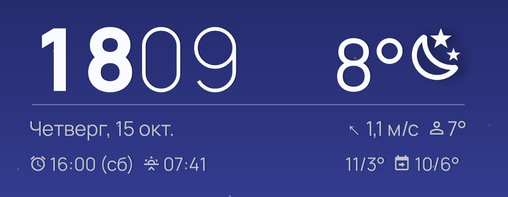
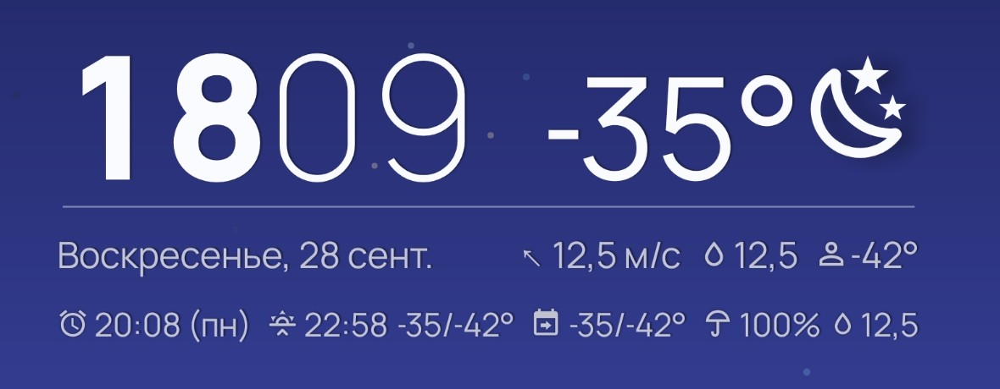

# Weather Bridge для KWGT

**Weather Bridge** — маленькое Android-приложение, которое передаёт прогноз из
[Breezy Weather](https://github.com/breezy-weather/breezy-weather) в
[KWGT](https://kustom.rocks/) готовыми переменными. Оно не ходит в интернет и не использует
геолокацию: погоду загружает Breezy, мост только пересылает её.

Здесь же лежит **Breezy Minimal** — виджет KWGT на этих переменных: крупные часы, температура
и иконка погоды, ниже дата, ветер, осадки, «ощущается как», ближайший будильник,
восход/закат и прогноз на сегодня и завтра.



> Независимый неофициальный проект. Не связан с Breezy Weather и Kustom Industries.

[English version](README.md)

## Как это работает

```
Breezy Weather ──(оповещение об обновлении)──▶ Weather Bridge ──(читает данные Breezy)
                                                     │
                                                     └──(передача в KWGT)──▶ $br(breezy, temp)$
```

Каждый раз, когда Breezy обновляет погоду, он оповещает мост; мост читает данные Breezy и
передаёт в KWGT около 40 переменных. Дневные и ночные иконки меняются на восходе и закате
даже без обновления.

## Что нужно

- Android 8.0+
- Breezy Weather **6.1.0+**
- KWGT 3.80+ (встроенные Material Design Icons)

## Установка

1. Скачайте `weather-bridge-*.apk` в [Releases](../../releases) и установите.
   У приложения **нет иконки на рабочем столе** — так задумано. Открыть его можно через
   **Настройки → Приложения → Weather Bridge → Настройки приложения** или из настроек Breezy.
2. Нажмите **«Разрешить доступ к Breezy»**.
3. В Breezy Weather: **Настройки → Виджеты и живые обои → «Отправить данные о погоде в Breezy
   Weather Оповеститель обновления местоположений»** → включите **Weather Bridge**.
4. Снимите ограничения по батарее для Weather Bridge и Breezy Weather (кнопка в приложении),
   чтобы система не блокировала обновления в фоне.
5. Обновите погоду в Breezy или нажмите **«Получить данные Breezy и передать в KWGT»**.

На экране моста есть список всех переменных; нажатие копирует формулу. Язык интерфейса —
английский или русский (переключатель в правом верхнем углу).

## Виджет Breezy Minimal

1. Скачайте `Breezy_Minimal_*.kwgt` (или `.zip` с ним) в [Releases](../../releases) или в
   папке [`widget/`](widget) и откройте в KWGT.
2. После первого импорта **один раз перезагрузите телефон**: встроенные шрифты Manrope на
   рабочем столе появляются только после перезагрузки.
3. Настройки в KWGT → **Глобальные**:

| Параметр | Что делает |
|---|---|
| `umbrella_min` | Порог зонтика: вероятность осадков завтра, % (в виджете 60; при 0 — 70) |
| `umbrella_test` | Всегда показывать зонтик (проверка) |
| `maximal` | Самые длинные значения во всех строках — проверка наложений |
| `precip_test` | Проверка иконки осадков: 0 реальные данные, 1 дождь, 2 снег, 3 снег с дождём |

С включённым `maximal` (самые длинные значения, шрифт мельче):



Строки сами выбирают крупный шрифт, если всё помещается, и мельче — если текст налезает.
Старые версии — в [`widget/archive`](widget/archive).

## Переменные

В KWGT: `$br(breezy, имя)$`.

| Группа | Переменная | Значение |
|---|---|---|
| Сейчас | `temp` | Текущая температура, ° (например, 8°) |
| Сейчас | `feels` | Ощущается как, с надписью Feels like |
| Сейчас | `like` | Ощущается как, только температура в градусах |
| Сейчас | `condition` | Текст текущей погоды из Breezy |
| Сейчас | `code` | Числовой погодный код (OpenWeather-подобный) |
| Сейчас | `icon` | Погодный символ Emoji |
| Сейчас | `icon_flat` | Название векторной иконки в шрифте Meteo |
| Сейчас | `icon_mdi` | Имя иконки Material Design Icons, как в виджетах Breezy (набор KWGT: Iconify → mdi) |
| Сейчас | `is_day` | 1 днём, 0 ночью (по почасовым данным Breezy) |
| Сейчас | `humidity` | Относительная влажность, % |
| Сейчас | `precip` | Вероятность осадков сейчас, % (если доступно) |
| Сейчас | `precip_now` | Осадки сейчас, мм (текущий час), пусто без осадков |
| Сейчас | `precip_now_type` | Вид осадков сейчас: rain (дождь), snow (снег), mix (мокрый снег), пусто без осадков |
| Сейчас | `precip_now_icon` | Иконка осадков сейчас (MDI): water-outline, snowflake, snowflake-melt |
| Сейчас | `details` | Общая строка: Like, стрелка ветра, м/с и влажность |
| Ветер | `wind` | Скорость ветра в km/h (английская подпись) |
| Ветер | `wind_kmh` | Скорость ветра в км/ч |
| Ветер | `wind_ms` | Скорость ветра в м/с |
| Ветер | `wind_direction` | Откуда дует ветер: С, СВ, В, ЮВ, Ю, ЮЗ, З, СЗ |
| Ветер | `wind_degrees` | Откуда дует ветер, азимут 0–359° |
| Ветер | `wind_arrow` | Стрелка направления, КУДА дует воздух |
| Ветер | `wind_text` | Сторона света (откуда) + скорость в м/с |
| Сегодня | `today_max` | Максимальная температура за сегодня, ° |
| Сегодня | `today_min` | Минимальная температура за сегодня, ° |
| Сегодня | `today_range` | Сегодня: максимум/минимум, например 10/7° |
| Сегодня | `today_compact` | Готовая строка Today: 10/7° |
| Завтра | `tomorrow_max` | Завтрашняя максимальная температура, ° |
| Завтра | `tomorrow_min` | Завтрашняя минимальная температура, ° |
| Завтра | `tomorrow_range` | Завтра: максимум ↑ и минимум ↓, ° |
| Завтра | `tomorrow` | Готовая строка «Завтра ↑… ↓…» |
| Завтра | `tomorrow_compact` | Готовая строка Tomorrow: 8/4° |
| Завтра | `tomorrow_precip` | Вероятность осадков завтра, % |
| Завтра | `tomorrow_precip_mm` | Осадки завтра, мм (день + ночь), пусто без осадков |
| Завтра | `tomorrow_precip_type` | Вид осадков завтра: rain, snow или mix, пусто без осадков |
| Завтра | `tomorrow_precip_icon` | Иконка осадков завтра (MDI): water-outline, snowflake, snowflake-melt |
| Завтра | `tomorrow_icon` | Завтрашняя погода — символ Emoji |
| Завтра | `tomorrow_icon_flat` | Иконка погоды завтра: название в наборе Meteo |
| Завтра | `tomorrow_icon_mdi` | Иконка Material Design Icons на завтра (Iconify → mdi) |
| Другое | `location` | Название населённого пункта из Breezy |

Вид осадков (`precip_now_type`, `tomorrow_precip_type`): Breezy даёт дождь, снег и лёд
отдельно (снег в мм воды). Меньшая из частей «дождь/снег» учитывается, если это хотя бы
четверть суммы; четверть льда — это `mix`; если источник погоды не делит осадки — `rain`.

## Если что-то не работает

**Breezy пишет «нет совместимых пакетов» или не видит мост.** На Android 11+ Breezy видит мост
только после того, как мост прочитал его данные. Мост делает это при включении телефона и после
обновления. Если не помогло: откройте мост, нажмите «Получить данные Breezy и передать в KWGT»,
полностью закройте Breezy, снова откройте его настройки и включите мост.

**Виджет показывает старые данные.** Проверьте ограничения по батарее (шаг 4) и время
«Данные получены» на экране моста.

## Сборка, структура, лицензия

См. [README.md](README.md#build). Лицензия — [GNU GPL v3.0](LICENSE).
